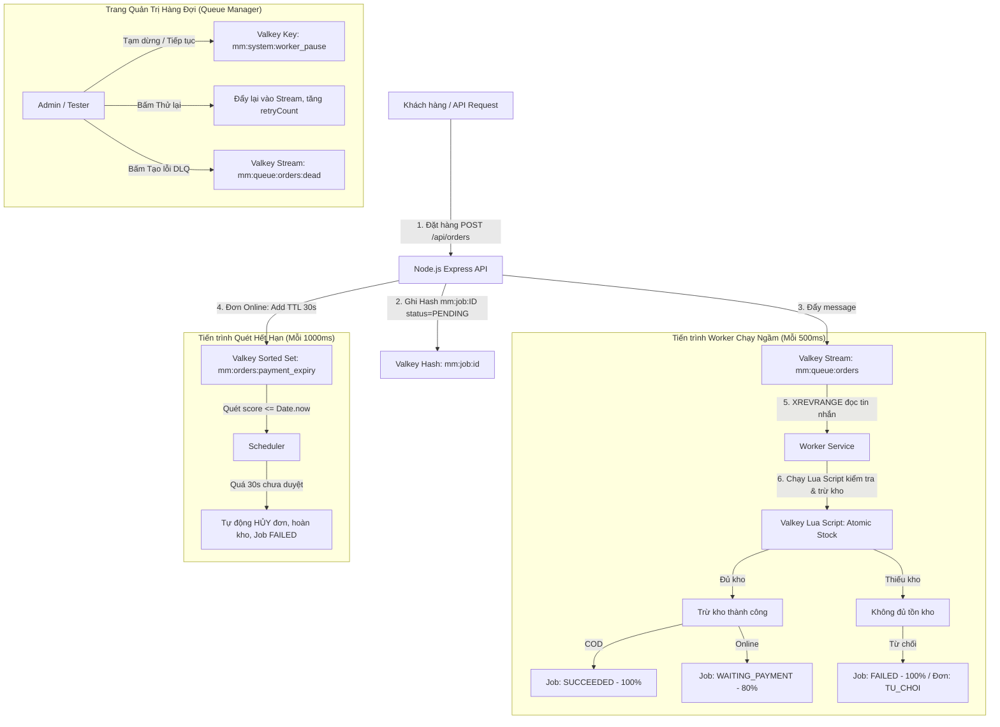
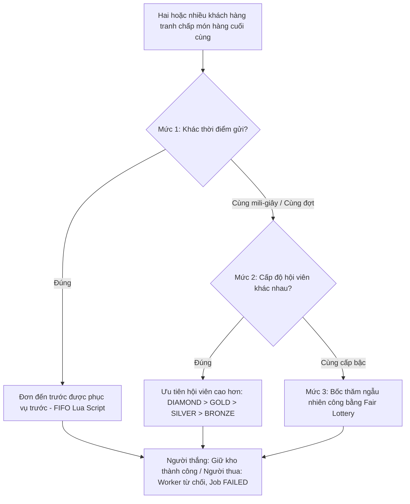
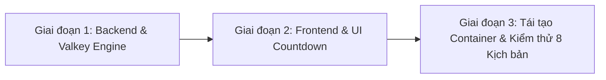

# BÁO CÁO KIẾN TRÚC WORKER VALKEY NOSQL & KỊCH BẢN KIỂM THỬ TOÀN DIỆN

---

## I. KIẾN TRÚC VÀ NGUYÊN LÝ HOẠT ĐỘNG CỦA WORKER

Hệ thống **MiniMart Valkey NoSQL** sử dụng **Valkey làm Message Broker, Bộ lưu trữ trạng thái (State Storage) và Công cụ khóa dữ liệu nguyên tử (Distributed Atomic Lock)** thay thế cho kiến trúc SQL + RabbitMQ/Kafka truyền thống.

---

## II. CHI TIẾT CÁC HOẠT ĐỘNG & VÒNG ĐỜI TRẠNG THÁI CỦA WORKER

| Trạng thái Job | Màu sắc UI | Tiến độ (%) | Ý nghĩa kỹ thuật trong Valkey | Khi nào xuất hiện? |
|---|---|---|---|---|
| **`PENDING`** | ⏳ Vàng | `0%` | Tin nhắn nằm trong Stream `mm:queue:orders`, chưa có Worker nào xử lý xong. | Khi đơn vừa tạo, hoặc khi Worker đang bị **Tạm dừng (Pause)**, hoặc sau khi Admin bấm **Thử lại (Retry)**. |
| **`PROCESSING`** | ⚙️ Xanh dương | `30%` | Worker đã nhặt tin nhắn và đang thực thi Lua Script khóa và kiểm tra tồn kho. | Tồn tại trong tích tắc khi Worker đang xử lý giao dịch nguyên tử. |
| **`WAITING_PAYMENT`** | 🕒 Tím lam | `80%` | Tồn kho đã được giữ thành công, đơn hàng nằm trong Sorted Set `mm:orders:payment_expiry` chờ thanh toán. | Khi khách hàng chọn thanh toán **VietQR / Chuyển khoản** và Worker đã giữ hàng thành công. |
| **`SUCCEEDED`** | ✅ Xanh lá | `100%` | Tác vụ hoàn tất trọn vẹn. | Với đơn COD: ngay sau khi giữ kho; Với đơn QR: sau khi Admin bấm xác nhận thanh toán thành công. |
| **`FAILED`** | ❌ Đỏ | `100%` | Tác vụ thất bại do lỗi nghiệp vụ hoặc quá thời gian. | **Trường hợp 1**: Khách đặt mua vượt tồn kho (Lua script từ chối). **Trường hợp 2**: Quá thời hạn 30s mà Admin chưa duyệt thanh toán. **Trường hợp 3**: Bị đưa vào Dead Letter Queue (`FAILED_DLQ`). |
| **`RETRYING`** | 🔄 Tím | `0% - 50%` | Job lỗi được đưa trở lại hàng đợi để xử lý lại lần thứ N. | Khi Admin bấm nút **Thử lại** trên bảng quản lý Job. |

---

## III. 4 PHƯƠNG PHÁP ĐỂ KIỂM THỬ HOẠT ĐỘNG WORKER

1. **Phương pháp 1: Kiểm thử trên Giao diện Web (UI Interactive Testing)**:
   * Mở song song 2 màn hình: Khách hàng mua sắm (`/cart`, `/checkout`) và Admin Quản lý hàng đợi (`/admin/queue`).
   * Bật tùy chọn **"Tự động cập nhật (3s)"** trên trang Admin để quan sát các chỉ số thay đổi theo thời gian thực.
2. **Phương pháp 2: Kiểm thử trên Valkey Admin (Port 18080 GUI)**:
   * Truy cập `http://localhost:18080`, quan sát trực tiếp các cấu trúc dữ liệu:
     * `XREVRANGE mm:queue:orders + -`: Xem các message trong hàng đợi Stream.
     * `ZRANGE mm:orders:payment_expiry 0 -1 WITHSCORES`: Xem danh sách đơn đang đếm ngược hạn thanh toán.
     * `HGETALL mm:job:<jobId>`: Xem chi tiết trạng thái, lỗi và số lần thử lại của Job.
3. **Phương pháp 3: Kiểm thử bằng API / Terminal (cURL / PowerShell)**:
   * Gửi request HTTP trực tiếp vào các endpoint hàng đợi để kiểm tra tải và phản hồi.
4. **Phương pháp 4: Kiểm thử tự động bằng Python Test Suite (`backend/tests/integration.py`)**:
   * Chạy kịch bản kiểm tra tranh chấp tồn kho với đa luồng đồng thời (concurrency threads).

---

## IV. BẢN KỊCH BẢN CHI TIẾT CỦA CÁC QUY TRÌNH (TEST SCENARIOS)

### Kịch bản 1: Quy trình Xử lý Thành công (Happy Path - COD & Online)
* **Mục tiêu**: Kiểm tra Worker xử lý đơn hàng hợp lệ, giữ kho thành công và cập nhật trạng thái SUCCEEDED.
* **Các bước thực hiện**:
  1. Đăng nhập tài khoản `user1` (pass: `pass1234`).
  2. Chọn sản phẩm *Cà chua Đà Lạt* (tồn kho còn nhiều), chọn số lượng `2`, thêm vào giỏ hàng.
  3. Vào thanh toán, chọn phương thức **Thanh toán khi nhận hàng (COD)** -> Bấm **Xác nhận đặt hàng**.
  4. Chuyển sang tài khoản `admin` -> Vào menu **Hàng Đợi Valkey (Queue Manager)**.
* **Kết quả kỳ vọng**:
  * Job mới được tạo và chuyển sang `SUCCEEDED` (màu xanh).
  * Chỉ số `Đã Xong Thành Công` tăng thêm 1.
  * Tồn kho sản phẩm bị trừ đúng 2 đơn vị.

---

### Kịch bản 2: Quy trình Lỗi Vượt Tồn Kho (Yêu cầu 1)
* **Mục tiêu**: Kiểm tra Worker phát hiện thiếu tồn kho bằng Lua script, từ chối đơn hàng và đánh dấu Job FAILED.
* **Các bước thực hiện**:
  1. Xem tồn kho sản phẩm *Gạo ST25* (ví dụ còn `10` túi).
  2. Khách hàng nhập số lượng `20` (vượt quá tồn kho 10 túi) và bấm **Đặt hàng** (COD hoặc Online).
  3. Mở trang **Queue Manager** của Admin.
* **Kết quả kỳ vọng**:
  * Đơn hàng được tiếp nhận và đẩy vào Stream `mm:queue:orders`.
  * Worker nhặt Job ra xử lý, Lua script phát hiện `currentStock (10) < quantity (20)`.
  * Job lập tức chuyển sang trạng thái **`FAILED` (màu đỏ)** với thông báo: *"Thiếu tồn kho sản phẩm thứ 1"*.
  * Chỉ số **Lỗi / DLQ** và **DB Failed** trên trang Admin tăng thêm 1.
  * Tại trang **Lịch sử đơn hàng** của khách: Đơn chuyển sang trạng thái **`Từ chối`** với lý do: *"Worker từ chối do thiếu tồn kho"*.

---

### Kịch bản 3: Quy trình Quá Hạn Thanh Toán 30 Giây (Yêu cầu 2)
* **Mục tiêu**: Kiểm tra Scheduler quét Sorted Set, tự động hủy đơn sau 30s nếu Admin chưa duyệt, chuyển Job sang FAILED và hoàn kho.
* **Các bước thực hiện**:
  1. Ghi nhận số lượng tồn kho ban đầu của sản phẩm *Sữa Vinamilk 1L* (ví dụ: `50` hộp).
  2. Khách hàng đặt mua `2` hộp, chọn phương thức **Chuyển khoản Ngân hàng (VietQR)**.
  3. Bấm Đặt hàng -> Modal mã QR hiển thị kèm **Đồng hồ đếm ngược 30 giây** (`00:30 -> 00:00`).
  4. Lúc này Worker đã giữ trước 2 hộp trong kho (tồn kho còn 48). Job đang ở trạng thái `WAITING_PAYMENT`.
  5. **Admin cố tình KHÔNG bấm duyệt thanh toán**.
  6. Chờ hết 30 giây.
* **Kết quả kỳ vọng**:
  * Hết 30 giây, modal QR của khách hàng chuyển sang màu đỏ: *"Đã hết thời hạn thanh toán 30 giây. Đơn hàng đã tự động bị hủy!"*.
  * Worker quét quá hạn kích hoạt: Đơn hàng chuyển sang `status: HUY`, `paymentStatus: FAILED`.
  * **Job trong Queue Manager tự động nhảy sang `FAILED`** với nội dung: *"Quá thời hạn thanh toán 30 giây (Admin chưa duyệt đơn)"*. Chỉ số Failed trên dashboard tăng lên 1.
  * Tồn kho sản phẩm tự động được hoàn lại: Từ `48` trở lại đúng `50` hộp ban đầu.

---

### Kịch bản 4: Quy trình Thử Lại (Retry Mechanism)
* **Mục tiêu**: Kiểm tra khả năng phục hồi lỗi của Worker khi điều kiện kho được khắc phục.
* **Các bước thực hiện**:
  1. Từ Kịch bản 2, Job bị `FAILED` do thiếu kho sản phẩm *Gạo ST25*.
  2. Admin vào mục **Quản lý sản phẩm** hoặc **Nhập kho** -> Cập nhật tăng số lượng tồn kho của *Gạo ST25* lên `100`.
  3. Admin quay lại trang **Queue Manager** -> Tìm đến Job bị lỗi -> Bấm nút **🔄 Thử lại** (Retry).
* **Kết quả kỳ vọng**:
  * Số lần thử lại (`retryCount`) tăng từ 0 lên 1.
  * Job quay trở lại trạng thái `PENDING` và được đẩy lại vào Stream.
  * Worker nhặt lại Job, kiểm tra kho lúc này đã có 100 túi -> Trừ kho thành công -> Job chuyển sang **`SUCCEEDED`**!
  * Đơn hàng từ `TU_CHOI` tự động được khôi phục và chuyển sang `CHO_XAC_NHAN`.

---

### Kịch bản 5: Tranh chấp tồn kho đồng thời đa cấp độ (3-Tier Concurrency Conflict Resolution)
* **Mục tiêu**: Đảm bảo tuyệt đối không bán âm kho khi nhiều khách hàng tranh mua sản phẩm khan hiếm (Flash Sale / Last Item), áp dụng thuật toán phân xử công bằng 3 cấp độ:

#### Chi tiết 3 Mức Phân Xử:
1. **Mức 1: Hai người mua khác thời điểm (First-Come, First-Served - FIFO)**
   * **Nguyên lý**: Nhờ bản chất đơn luồng (single-threaded) của Valkey Server và tính nguyên tử của Lua Script, đơn hàng đến trước dù chỉ 1 mili-giây sẽ được đưa vào Stream trước. Lua Script trừ kho thành công cho người đến trước. Người đến sau đọc kho bằng 0 sẽ bị Worker từ chối ngay lập tức.
   * **Kịch bản test**:
     - Sản phẩm còn `1` cái tồn kho.
     - Tài khoản A đặt hàng lúc `10:00:00.100`. Tài khoản B đặt hàng lúc `10:00:00.150`.
     - **Kết quả**: Đơn của A thành công (`SUCCEEDED`), đơn của B bị từ chối (`FAILED`), tồn kho về `0`.

2. **Mức 2: Hai người mua cùng thời điểm theo độ chính xác hệ thống (Membership Tier Priority)**
   * **Nguyên lý**: Khi 2 đơn hàng gửi lên trong cùng một khung thời gian (cùng mili-giây hoặc cùng đợt xử lý batch), hệ thống so sánh **Trọng số cấp độ hội viên (Tier Weight)**:
     $$\text{DIAMOND (4)} > \text{GOLD (3)} > \text{SILVER (2)} > \text{BRONZE (1)}$$
     Worker sẽ sắp xếp thứ tự ưu tiên (Priority Queue) dựa trên điểm hội viên trước khi gọi Lua Script trừ kho.
   * **Kịch bản test**:
     - Sản phẩm còn `1` cái tồn kho.
     - Khách hàng VIP `user1` (Hạng **GOLD**) và Khách hàng mới `user2` (Hạng **BRONZE**) cùng submit đơn mua cùng 1 thời điểm.
     - **Kết quả**: Hệ thống ưu tiên đơn của `user1` (GOLD) giữ hàng thành công (`SUCCEEDED`). Đơn của `user2` (BRONZE) bị Worker từ chối (`FAILED`) do nhường quyền ưu tiên tồn kho.

3. **Mức 3: Cùng thời điểm và Cùng cấp độ hội viên (Fair Random Lottery)**
   * **Nguyên lý**: Nếu cả thời điểm và hạng thành viên đều trùng nhau (ví dụ 2 khách hàng cùng hạng **SILVER**), hệ thống kích hoạt cơ chế **Bốc thăm ngẫu nhiên công bằng (Fair Random Tie-Breaker)** bằng hàm bốc thăm `Math.random()` hoặc hàm băm ngẫu nhiên trong Worker/Lua.
   * **Kịch bản test**:
     - Sản phẩm còn `1` cái tồn kho.
     - Hai khách hàng `userA` (SILVER) và `userB` (SILVER) cùng bấm mua đồng thời.
     - **Kết quả**: Hệ thống bốc thăm ngẫu nhiên 50/50. Người trúng thăm giữ hàng thành công, người còn lại nhận thông báo: *"Rất tiếc, bạn không may mắn trong lượt bốc thăm giữ sản phẩm cuối cùng"* và Job chuyển `FAILED`. Tồn kho kết thúc chính xác bằng `0`.

---

## V. KẾ HOẠCH TRIỂN KHAI HOÀN CHỈNH (CONSOLIDATED PLAN)

### Giai đoạn 1: Backend & Valkey Engine (`server.js` & `docker-compose.yml`)
1. **Rút ngắn TTL thanh toán:**
   * Cập nhật `PAYMENT_TTL_SECONDS: 30` trong `docker-compose.yml` và fallback mặc định `30` trong `server.js`.
2. **Nâng cấp Worker Expiry Scheduler (Xử lý lỗi quá hạn 30s):**
   * Khi đơn quá hạn trong ZSET `mm:orders:payment_expiry`:
     * Đổi trạng thái đơn thành `HUY`, `paymentStatus = 'FAILED'`.
     * Đổi trạng thái Job trong Worker thành **`FAILED`** (thay vì `EXPIRED_CANCELLED`) với message: *"Quá thời hạn thanh toán 30 giây (Admin chưa duyệt đơn)"*.
     * Hoàn lại tồn kho cho sản phẩm (`restoreStock`).
     * Ghi log `ERROR` để đồng bộ thẻ Failed trên Queue Manager.
3. **Mở luồng đặt hàng vượt tồn kho (Kịch bản 2):**
   * Cho phép API giỏ hàng và API đơn hàng tiếp nhận đơn vượt tồn kho khi có cờ test hoặc điều chỉnh validation để đơn luôn được đẩy vào Valkey Stream `mm:queue:orders` ở trạng thái `CHO_TIEP_NHAN`.
   * Luồng Worker nhặt đơn xử lý bất đồng bộ: Khi Lua script phát hiện tồn kho thiếu, Worker tự động đánh dấu Job `FAILED` và đơn `TU_CHOI`.
4. **Cập nhật API Retry Job (Kịch bản 4):**
   * Khi retry Job bị `TU_CHOI`, tự động đưa đơn về `CHO_TIEP_NHAN` và đẩy lại vào Stream.
5. **Cơ chế phân xử tranh chấp tồn kho 3 mức (Kịch bản 8):**
   * Khi Worker nhặt mẻ đơn trong cùng khung thời gian tranh chấp sản phẩm cuối:
     * **Mức 1**: Đơn đến trước được phục vụ trước (FIFO).
     * **Mức 2**: Nếu cùng thời điểm, ưu tiên theo điểm xếp hạng hội viên: `DIAMOND (4) > GOLD (3) > SILVER (2) > BRONZE (1)`.
     * **Mức 3**: Nếu cùng thứ hạng hội viên, bốc thăm ngẫu nhiên công bằng (`Math.random()`), người thắng giữ kho, người thua chuyển `TU_CHOI` và Job `FAILED`.

### Giai đoạn 2: Giao diện Frontend (`frontend/src`)
1. **Modal VietQR (`Checkout.jsx`):**
   * Bổ sung **Đồng hồ đếm ngược 30 giây** trực quan (`00:30` -> `00:00`) với thanh tiến trình gradient.
   * Cơ chế tự động Polling (mỗi 1s) trạng thái đơn hàng:
     * Nếu Admin duyệt: Tự động báo *"Thanh toán thành công"* và chuyển trang.
     * Nếu quá 30s bị Worker hủy: Tự động chuyển giao diện sang cảnh báo đỏ *"Đã quá thời hạn thanh toán 30 giây. Đơn hàng đã tự động hủy và hoàn lại kho."* kèm nút đóng.
2. **Giỏ hàng & Chi tiết sản phẩm (`Cart.jsx`, `ProductDetail.jsx`):**
   * Cho phép tăng số lượng vượt tồn kho để người dùng dễ dàng thực hiện kịch bản test Worker từ chối đơn.
3. **Queue Manager (`QueueManager.jsx`):**
   * Đảm bảo các Job bị Timeout quá hạn 30s được phân loại đúng vào bộ lọc và thẻ KPI `Lỗi / DLQ`.

### Giai đoạn 3: Rebuild Docker & Kiểm thử toàn diện
1. Rebuild container backend/frontend bằng `docker compose up --build -d`.
2. Hướng dẫn người dùng các bước click chuột cụ thể để kiểm thử lần lượt từng kịch bản trong 8 kịch bản trên.
