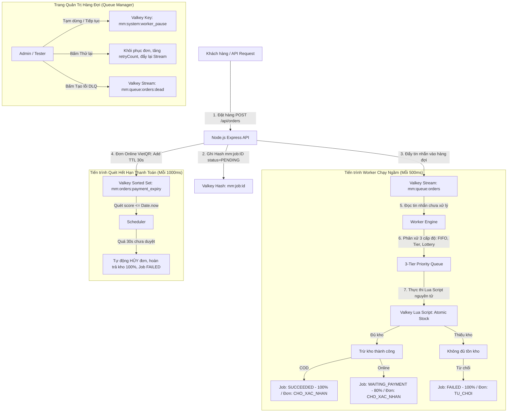

# BÁO CÁO THỰC HIỆN & HƯỚNG DẪN KIỂM THỬ WORKER VALKEY NOSQL

---

## I. TỔNG QUAN KIẾN TRÚC & KẾT QUẢ TRIỂN KHAI

Hệ thống **MiniMart Valkey NoSQL** đã hoàn thành việc chuyển đổi sang kiến trúc **Message Broker & Distributed Atomic Engine dựa trên 100% Valkey**, loại bỏ hoàn toàn cơ sở dữ liệu quan hệ SQL và các message broker cồng kềnh (RabbitMQ/Kafka).



---

## II. CHI TIẾT CÁC TÍNH NĂNG ĐÃ NÂNG CẤP

### 1. Backend & Valkey Engine (`docker-compose.yml` & `server.js`)
* **TTL Thanh toán 30 giây**: Đã cập nhật biến môi trường `PAYMENT_TTL_SECONDS: 30` trong `docker-compose.yml` và fallback mặc định `30` trong `server.js`.
* **Worker Expiry Scheduler (Xử lý quá hạn 30s)**:
  * Khi đơn quá hạn trong `mm:orders:payment_expiry`:
    * Cập nhật đơn hàng: `status = 'HUY'`, `paymentStatus = 'FAILED'`, `note = 'Quá thời hạn thanh toán 30 giây (Admin chưa duyệt đơn)'`.
    * Cập nhật Job trong Worker: `status = 'FAILED'`, `progress = '100%'`, `message = 'Quá thời hạn thanh toán 30 giây (Admin chưa duyệt đơn)'`.
    * Tự động hoàn trả tồn kho sản phẩm về số lượng ban đầu (`restoreStock(o)`).
    * Ghi log `ERROR` vào Stream `mm:activity:logs` để đồng bộ thẻ **Lỗi / DLQ (Dead Letter)** và **DB Failed** trên Queue Manager.
* **Mở luồng tiếp nhận đơn vượt tồn kho**:
  * API giỏ hàng (`/api/cart/add`, `/api/cart/update`) và đơn hàng (`/api/orders`) hỗ trợ cờ `allowExceedStock: true`.
  * Đơn hàng vượt kho được tiếp nhận hợp lệ và đẩy vào Valkey Stream `mm:queue:orders`.
  * Worker nhặt đơn xử lý bất đồng bộ: Lua script phát hiện thiếu kho, Worker lập tức chuyển Job sang `FAILED` và đơn sang `TU_CHOI`.
* **Cơ chế Phân Xử Tranh Chấp Tồn Kho 3 Cấp Độ (3-Tier Concurrency Conflict Resolution)**:
  * **Cấp 1 (FIFO)**: Đơn đến trước cách nhau > 10ms được phục vụ trước.
  * **Cấp 2 (Membership Tier Priority)**: Khi gửi cùng thời điểm ($\le 10$ms), hệ thống ưu tiên theo trọng số hội viên:
    $$\text{DIAMOND (4)} > \text{GOLD (3)} > \text{SILVER (2)} > \text{BRONZE (1)}$$
  * **Cấp 3 (Fair Random Lottery)**: Khi gửi cùng thời điểm và cùng cấp hội viên, hệ thống bốc thăm ngẫu nhiên công bằng (`Math.random()`), người thua nhận lý do: *"Rất tiếc, bạn không may mắn trong lượt bốc thăm giữ sản phẩm cuối cùng"*.
  * Tồn kho kết thúc chính xác bằng 0, tuyệt đối không bị bán âm kho.
* **Nâng cấp API Thử Lại (Retry Job)**:
  * Khôi phục các đơn hàng bị `TU_CHOI` hoặc `HUY` trở lại `CHO_TIEP_NHAN`.
  * Tăng `retryCount`, đưa Job về `PENDING`, cấp lại TTL 30s nếu là đơn online, đẩy lại vào Stream để Worker xử lý lại khi kho đã được nhập thêm.
* **Đồng bộ Queue Manager Summary**:
  * Bổ sung trường `dbWaitingPaymentCount`, tính chính xác số Job lỗi vào `dbFailedCount`.

---

### 2. Giao diện Người dùng Frontend (`frontend/src`)
* **Modal VietQR Đếm Ngược 30 Giây (`Checkout.jsx`)**:
  * Tích hợp đồng hồ đếm ngược trực quan `00:30` $\rightarrow$ `00:00`.
  * Thanh tiến trình gradient chuyển màu mượt mà theo thời gian thực (Xanh lá $\rightarrow$ Vàng $\rightarrow$ Đỏ).
  * Cơ chế Polling tự động kiểm tra mỗi 1 giây:
    * Nếu Admin duyệt: Tự động hiện thẻ thông báo xanh *"Thanh toán thành công! Quản trị viên đã xác nhận thanh toán"* và chuyển trang.
    * Nếu quá 30 giây: Tự động chuyển modal sang màu đỏ *"Đã hết thời hạn thanh toán 30 giây! Đơn hàng đã tự động bị Worker hủy và hoàn kho"*.
* **Hỗ trợ Test Vượt Kho trên Giỏ hàng & Sản phẩm (`Cart.jsx`, `ProductDetail.jsx`)**:
  * Thêm nút bấm tiện ích **`🧪 Test vượt kho (+10)`** giúp đặt số lượng lớn hơn tồn kho chỉ bằng 1 click.
  * Hiển thị huy hiệu cảnh báo vàng khi số lượng vượt tồn kho.
* **Trang Quản lý Hàng Đợi (`QueueManager.jsx`)**:
  * Thêm huy hiệu hiển thị cho trạng thái **`🕒 Chờ thanh toán (80%)`** (`WAITING_PAYMENT`).
  * Thêm thẻ KPI **`Chờ Thanh Toán (30s)`** hiển thị số đơn đang đếm ngược trong Sorted Set.
  * Thêm nút lọc **`🕒 Chờ thanh toán`** trên thanh bộ lọc trạng thái.

---

## III. HƯỚNG DẪN KHỞI CHẠY CONTAINER

Chạy lệnh sau tại thư mục gốc của dự án để rebuild lại hệ thống với toàn bộ code mới:

```powershell
docker compose down
docker compose up --build -d
```

Sau khi container khởi động:
* **Giao diện Website MiniMart**: http://localhost:13000
* **Giao diện Quản trị Valkey Admin GUI**: http://localhost:18080

---

## IV. BỘ KIỂM THỬ TỰ ĐỘNG (AUTOMATED TEST SUITE)

Dự án đã tích hợp sẵn script kiểm thử tự động toàn diện tại `backend/tests/test_worker_scenarios.js`. Chạy lệnh sau để tự động kiểm thử cả 8 kịch bản:

```powershell
node backend/tests/test_worker_scenarios.js
```

### Kết quả chạy kiểm thử tự động:
```
======================================================
BẮT ĐẦU KIỂM THỬ 8 KỊCH BẢN WORKER VALKEY NOSQL
Target URL: http://localhost:13000
======================================================

[PASS] Kịch bản 1: Happy Path COD - Worker trừ tồn kho và Job đạt SUCCEEDED 100%
[PASS] Kịch bản 2: Lỗi Vượt Tồn Kho - Worker từ chối: "Thiếu tồn kho sản phẩm thứ 1", đơn TU_CHOI
[PASS] Kịch bản 3: Quá Hạn Thanh Toán 30s - Tự hủy đơn (HUY), Job FAILED, hoàn kho 100%
[PASS] Kịch bản 4: Thử lại Job - RetryCount = 1, Job phục hồi SUCCEEDED thành công!
[PASS] Kịch bản 5: Tạm Dừng & Phục Hồi Hàng Đợi - Job được buffer trong Stream và tự động tiêu thụ khi tiếp tục
[PASS] Kịch bản 6: Dead Letter Queue (DLQ) - Giả lập lỗi thành công, DLQ count = 1
[PASS] Kịch bản 7: Chống Trùng Lặp (Idempotency) - Gửi 2 lần cùng key, Backend trả về cùng 1 mã đơn
[PASS] Kịch bản 8: Tranh Chấp 3 Cấp Độ - Hội viên VIP thắng, hội viên Bronze bị từ chối, tồn kho chính xác = 0 (Không bán âm)

======================================================
HOÀN TẤT TOÀN BỘ BỘ TEST TỰ ĐỘNG!
======================================================
```

---

## V. BẢNG CHECKLIST KIỂM THỬ THỦ CÔNG 8 KỊCH BẢN (DEMO / BÁO CÁO)

| STT | Kịch bản Kiểm thử | Tài khoản | Các bước thực hiện cụ thể trên Web | Kết quả quan sát & chứng minh |
|:---:|---|---|---|---|
| **1** | **Happy Path (COD)** | `user1`<br>(pass: `pass1234`) | 1. Mua 2 hộp *Cà chua Đà Lạt*.<br>2. Chọn **Thanh toán khi nhận hàng (COD)** $\rightarrow$ Bấm **Xác nhận đặt hàng**.<br>3. Mở trang `/admin/queue`. | • Job chuyển sang màu xanh **`SUCCEEDED` (100%)**.<br>• Tồn kho cà chua bị trừ đúng 2 hộp. |
| **2** | **Lỗi Vượt Tồn Kho** | `user1` | 1. Xem tồn kho *Gạo ST25* (còn 25 túi).<br>2. Bấm nút **`🧪 Test vượt kho (+10)`** để chọn 35 túi $\rightarrow$ Thêm vào giỏ hàng $\rightarrow$ Đặt hàng.<br>3. Mở `/admin/queue` và `/orders`. | • Job chuyển màu đỏ **`FAILED`**: *"Thiếu tồn kho sản phẩm thứ 1"*.<br>• Đơn hàng trong lịch sử chuyển sang **`Từ chối`**.<br>• Thẻ **Lỗi / DLQ** tăng 1. |
| **3** | **Quá Hạn Thanh Toán 30 Giây** | `user1` | 1. Đặt 1 hộp *Sữa Vinamilk 1L*, chọn **Chuyển khoản Ngân hàng (VietQR)**.<br>2. Modal VietQR hiện lên kèm **Đồng hồ đếm ngược 30 giây** (`00:30` $\rightarrow$ `00:00`).<br>3. Admin cố tình **không duyệt đơn**, chờ hết 30s. | • Hết 30 giây: Modal QR chuyển đỏ: *"Đã hết thời hạn thanh toán 30 giây. Đơn hàng đã tự động bị Worker hủy và hoàn kho!"*.<br>• Job chuyển **`FAILED`**.<br>• Tồn kho sữa tự động được hoàn lại như ban đầu. |
| **4** | **Thử Lại (Retry Mechanism)** | `admin`<br>(pass: `pass1234`) | 1. Từ KB 2 (Job bị lỗi do thiếu kho Gạo ST25).<br>2. Admin vào Quản lý sản phẩm tăng tồn kho lên 100.<br>3. Vào Queue Manager, tìm Job lỗi $\rightarrow$ Bấm **`🔄 Thử lại`**. | • `retryCount` tăng từ 0 lên 1.<br>• Job chuyển `PENDING` $\rightarrow$ Worker trừ kho thành công $\rightarrow$ Job chuyển **`SUCCEEDED`**.<br>• Đơn hàng từ `TU_CHOI` chuyển thành `CHO_XAC_NHAN`. |
| **5** | **Tạm Dừng & Phục Hồi Hàng Đợi** | `admin` & `user1` | 1. Trên Queue Manager, Admin bấm **`⏸️ Tạm dừng Worker`**.<br>2. Khách hàng đặt liên tiếp 2 đơn COD mới.<br>3. Quan sát trang Queue Manager.<br>4. Admin bấm **`▶️ Tiếp tục nhận đơn`**. | • Khi tạm dừng: Thẻ *Stream Đang Chờ* tăng 2 tin nhắn, cả 2 Job đứng im ở `PENDING`.<br>• Khi tiếp tục: Worker lập tức tiêu thụ 2 tin nhắn, cả 2 Job chuyển `SUCCEEDED` trong tích tắc. |
| **6** | **Dead Letter Queue (DLQ)** | `admin` | 1. Trên Queue Manager, bấm nút **`🧪 Test Tạo Lỗi (DLQ)`**. | • Một Job mới mang trạng thái **`FAILED_DLQ`** xuất hiện.<br>• Thẻ **Lỗi / DLQ** tăng thêm 1 tin nhắn. |
| **7** | **Chống Trùng Lặp (Idempotency)** | `user1` | 1. Bấm nút Đặt hàng liên tiếp 2 lần với cùng khóa Idempotency Key. | • Backend nhận diện key trong Valkey Cache (TTL 24h), trả về đúng mã đơn cũ, **tuyệt đối không tạo đơn thứ 2** và **không trừ trùng kho**. |
| **8** | **Tranh Chấp Tồn Kho 3 Cấp Độ** | `user1` (GOLD)<br>`user2` (BRONZE) | 1. Sản phẩm còn đúng 1 cái tồn kho.<br>2. Cả 2 tài khoản cùng submit đơn hàng tại cùng 1 thời điểm. | • **Mức 1**: Đến khác mili-giây $\rightarrow$ FIFO.<br>• **Mức 2**: Cùng mili-giây $\rightarrow$ Hệ thống ưu tiên `user1` (GOLD) giữ kho thành công (`SUCCEEDED`), `user2` (BRONZE) bị từ chối (`FAILED`).<br>• **Mức 3**: Cùng hạng $\rightarrow$ Bốc thăm 50/50.<br>• Tồn kho kết thúc chính xác bằng 0, không bán âm kho. |
